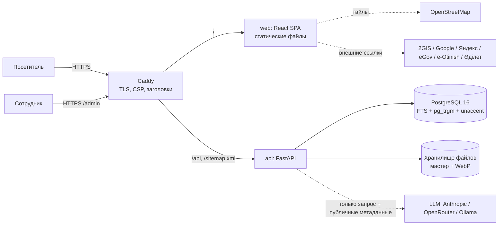
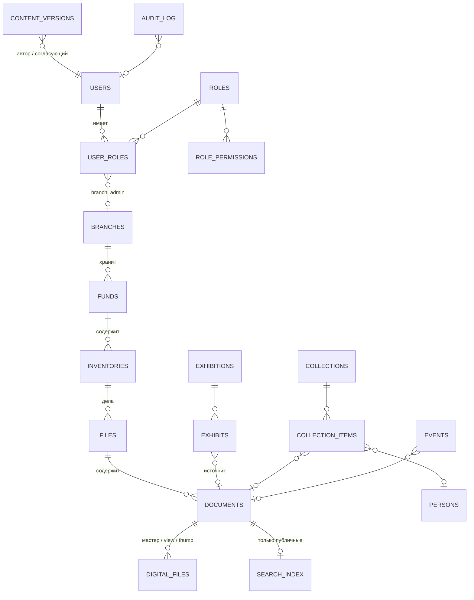

# Архитектура

## Модули

| Модуль API | Каталог | Назначение |
|---|---|---|
| core | `app/core` | настройки (.env), БД, логирование без секретов, i18n-фолбэк, rate limit |
| catalog | `app/catalog` | публичный каталог; **все правила доступа — `access.py`** |
| search | `app/search` | интерфейс `SearchBackend`, реализация на Postgres FTS, синонимы |
| media | `app/media` | хранилище, проверка сигнатуры, WebP, выдача файлов с проверкой прав |
| cms | `app/cms` | страницы, новости, FAQ, отзывы, PDF по белому списку, bleach |
| public / history_router | `app/public`, `app/history_router.py` | филиалы, памятные даты, выставки, история |
| ai | `app/ai` | `LLMProvider` (Anthropic/OpenRouter/Ollama/RuleBased), пайплайн, валидатор |
| auth / admin / workflow / audit | `app/auth`, `app/admin`, `app/workflow.py`, `app/audit.py` | сессии, права, CRUD, согласование, журнал |
| seo | `app/seo.py` | sitemap только по публичным карточкам |

Фронтенд: `web/src/app` (роутинг, язык из URL, тема), `components`, `pages`, `features` (каталог, помощник),
`admin` (отдельный чанк). Разделение кода по маршрутам, ленивая загрузка картинок, WebP-копии.

## Модель данных (основное)

Все сущности: UUID, `created_at/updated_at`. Переводимые поля — таблицы `*_translations(entity_id, lang, …,
translation_status: original|verified|machine|missing)`. Статусы: `description_status` (public|hidden|review) и
`file_access` (open|restricted|closed) независимы; `workflow_status` (draft…archived) — редакционный. CHECK-ограничения
на все перечни. Также: `news`, `pages`, `faq(+groups)`, `memorial_dates`, `feedback`, `search_log`, `synonyms`.

## Правила доступа (кратко)

- Карточка видна ⇔ она и все предки `public` + `published`; иначе 404. Файл ⇔ видимая карточка + `file_access=open` +
  производная копия; иначе 403. Мастер-копии наружу не выдаются. Каталог файлов не монтируется как статика.
- Индекс `search_index` перестраивается при каждом изменении статуса и содержит только видимые записи → поиск и ИИ
  физически не видят скрытого.
- Админка: JWT в httpOnly-cookie (SameSite=Strict), CSRF double-submit с токеном внутри подписанного JWT, скользящий
  срок 30 мин, абсолютный 8 ч; argon2; rate limit входа. Права из БД проверяются на каждый запрос и объект.

## API

OpenAPI: `/api/docs` (Swagger), `/api/openapi.json`. Группы: `catalog`, `media`, `public`, `cms`, `history`,
`assistant`, `auth`, `admin:*`.

## Почему PostgreSQL FTS, а не Elasticsearch

- Один сервис вместо двух: проще эксплуатация в гос-инфраструктуре и за 36 ч хакатона.
- Индекс в той же транзакции, что и статус доступа: снятие с публикации мгновенно убирает запись из поиска — нет
  окна, когда закрытое ещё ищется во внешнем индексе.
- `russian` стемминг + `simple` для kk/en, `unaccent`, `pg_trgm` для опечаток, таблица синонимов
  (Өскемен/Усть-Каменогорск/Oskemen, Риддер/Лениногорск…). На объёме до сотен тысяч описаний — достаточно.

**Миграция на OpenSearch:** поиск скрыт за протоколом `SearchBackend` (`search`, `index_document`, `rebuild`).
Новая реализация `OpenSearchBackend` + outbox-таблица событий изменения статуса (транзакционно пишется вместе с
изменением) и воркер, который применяет их к индексу. Публичный API каталога не меняется. Для kk — анализатор
с кастомными стоп-словами, синонимы переносятся в synonym graph filter.

## Библиотеки и лицензии

| Компонент | Лицензия |
|---|---|
| FastAPI, Starlette, Pydantic, SQLAlchemy, Alembic, asyncpg, uvicorn, httpx | MIT / BSD |
| passlib (argon2-cffi), PyJWT, itsdangerous, bleach, structlog, slowapi/limits | BSD / MIT / Apache-2.0 |
| Pillow (HPND), pypdfium2 (Apache-2.0/BSD), openpyxl (MIT), pytesseract (Apache-2.0) | свободные |
| anthropic (MIT) | SDK Claude |
| React, React Router, TanStack Query, i18next, Vite, Tailwind, DOMPurify | MIT (DOMPurify: Apache-2.0/MPL-2.0) |
| Leaflet (BSD-2), react-leaflet (Hippocratic-2.1), react-zoom-pan-pinch (MIT) | свободные |
| PostgreSQL (PostgreSQL License), Caddy (Apache-2.0) | свободные |
| Тайлы OpenStreetMap | ODbL, с атрибуцией |
